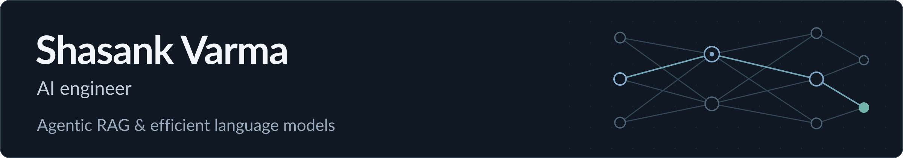

I’m an AI engineer interested in machine learning, software development, and building practical tools.

[LinkedIn](https://www.linkedin.com/in/shasank-varma-06a5a72ab/) · [Email](mailto:sasank.srivatsavai@gmail.com)

## Experience and highlights

- **AI/ML Engineering Intern at Zigma Neural** (February–July 2026): built adaptive retrieval, asynchronous document ingestion, and cited answer streaming with LangGraph, Pinecone, FastAPI, and React.
- **5× hackathon winner**, including CognitiveX GenAI (**1st of 200+ teams**; GVP, SmartBridge & IBM) and AI Build-A-Thon (**1st place**; AI for Vizag, Evolutyz Corp.).
- **Language model training:** [1.1763 bits per byte in 15.50 MB](https://github.com/shasank0001/parameter-golf/blob/main/docs/RESULTS.md), measured after export and reload. A single-GPU, unlimited-compute, non-record experiment in my fork of OpenAI's Parameter Golf.

## Featured projects

- **[Blog-Gen](https://github.com/shasank0001/Blog-Gen)** — Researches, writes, and critiques cited articles from web sources and private documents, with human outline approval. [Output screenshot](https://github.com/shasank0001/Blog-Gen/blob/main/assets/screenshots/step6_result.png).
- **[Self-RAG](https://github.com/shasank0001/self-RAG)** — Document chat with access-controlled workspaces, source citations, query rewriting, grounding checks, and resumable streaming. [Pipeline design](https://github.com/shasank0001/self-RAG/blob/main/docs/pipeline_change_summary.md).
- **[Parameter Golf](https://github.com/shasank0001/parameter-golf)** — Shared-block recurrence, ternary MLP weights, and mixed-bit export under a 16 MB artifact budget. [Results and logs](https://github.com/shasank0001/parameter-golf/blob/main/docs/RESULTS.md) · [Reproduction guide](https://github.com/shasank0001/parameter-golf/blob/main/docs/REPRODUCING.md).
- **[FactFinder](https://github.com/shasank0001/fact-finder)** — Evidence-assisted news checks and heuristic website/job risk checks, with optional image-origin classification and explicit limitations.
- **[Blast Radius](https://github.com/shasank0001/Blast-radius)** — MCP tools for explaining Python change impacts through structural analysis, data lineage, semantic search, Git history, and tests. [Example report](https://github.com/shasank0001/Blast-radius/blob/main/docs/DEMO_E2E_BLAST_RADIUS_REPORT.md).
- **[Medi-Co](https://github.com/shasank0001/medi-co)** — Healthcare prototype for drug interaction lookup, AI-assisted prescription review, and medical document summaries using FastAPI, React, and Gemini.

## Education and skills

**B.Tech in Computer Science (AI & ML)** · Gayatri Vidya Parishad College of Engineering · Expected **2027**

- **Languages:** Python, SQL, TypeScript, JavaScript
- **AI and ML:** PyTorch, Hugging Face, LangGraph, LangChain, RAG, multi-agent systems, LoRA, quantization-aware training
- **Applications:** FastAPI, React, PostgreSQL, Pinecone, Docker, Linux, Git
