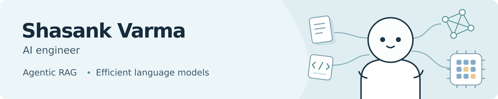

**5× hackathon winner** building AI applications and compact language models.

`Python` · `PyTorch` · `LangGraph` · `FastAPI` · `React`

[LinkedIn](https://www.linkedin.com/in/shasank-varma-06a5a72ab/) · [Email](mailto:sasank.srivatsavai@gmail.com) · [Training results](https://github.com/shasank0001/parameter-golf/blob/main/docs/RESULTS.md)

Background &amp; experiment details

- **Experience:** AI/ML Engineering Intern, Zigma Neural (February–July 2026).
- **Education:** B.Tech CS (AI & ML), Gayatri Vidya Parishad College of Engineering; expected 2027.
- **Wins:** CognitiveX GenAI (1st of 200+ teams) and AI Build-A-Thon (1st place), among five hackathon wins.
- **Parameter Golf:** 1.1763 bits per byte in 15.50 MB after export and reload. My single-GPU, unlimited-compute, non-record experiment in a fork of OpenAI's project. [Results and evidence](https://github.com/shasank0001/parameter-golf/blob/main/docs/RESULTS.md).

